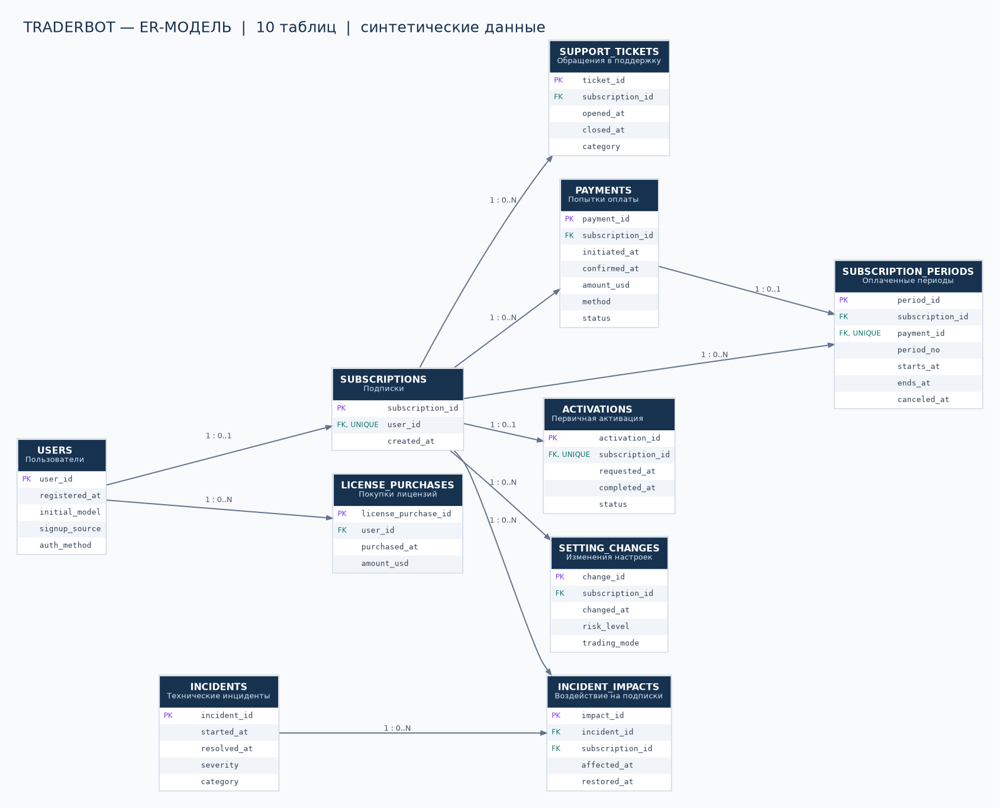

# Модель данных TraderBot

**СУБД:** PostgreSQL.   
**Основание:** [Метрики эффективности](metrics.md) и требования проекта.

> Это проектная аналитическая модель, а не описание реальной базы данных TraderBot. Реальные клиентские и брокерские данные не используются.

> Модель содержит только сущности, необходимые для расчёта утверждённых метрик и проверки четырёх аналитических гипотез.

## 1. Состав таблиц

| № | Таблица | Назначение |
|---|---|---|
| 1 | `users` | Пользователи и регистрации |
| 2 | `subscriptions` | Подписки пользователей |
| 3 | `payments` | Попытки оплаты и подтверждённые платежи |
| 4 | `subscription_periods` | Оплаченные периоды подписки |
| 5 | `activations` | Первичная активация |
| 6 | `setting_changes` | Изменения торговых настроек |
| 7 | `incidents` | Технические инциденты |
| 8 | `incident_impacts` | Воздействие инцидентов на подписчиков |
| 9 | `support_tickets` | Обращения в техническую поддержку |
| 10 | `license_purchases` | Покупки бессрочных лицензий |

### ER-диаграмма

[Исходник диаграммы Mermaid](../diagrams/erd.mmd)

---

## 2. Описание таблиц

### 2.1. users — Пользователи

Хранит информацию о зарегистрированных пользователях.

| Поле | Описание |
|---|---|
| `user_id` | Идентификатор пользователя, PK |
| `registered_at` | Дата регистрации |
| `initial_model` | Первоначально выбранная модель использования |
| `signup_source` | Канал привлечения |
| `auth_method` | Способ регистрации: email или Telegram |

Одна запись соответствует одному пользователю.

Первоначальный выбор модели не исключает последующего перехода на другую модель.

**Использование:** анализ регистраций, воронки, когорт и конверсии.

### 2.2. subscriptions — Подписки

Хранит информацию о подписках пользователей.

| Поле | Описание |
|---|---|
| `subscription_id` | Идентификатор подписки, PK |
| `user_id` | Идентификатор пользователя, FK, UNIQUE |
| `created_at` | Дата создания подписки |

В рамках синтетической модели один пользователь может иметь не более одной подписки.

Текущее состояние подписки определяется по оплаченным периодам и информации об отмене.

### 2.3. payments — Платежи

Хранит информацию о попытках оплаты подписки.

| Поле | Описание |
|---|---|
| `payment_id` | Идентификатор платежа, PK |
| `subscription_id` | Идентификатор подписки, FK |
| `initiated_at` | Время инициирования платежа |
| `confirmed_at` | Время подтверждения оплаты |
| `amount` | Сумма платежа |
| `method` | Способ оплаты |
| `status` | Статус платежа |

Возможные статусы:

- `pending` — ожидание подтверждения;
- `confirmed` — оплата подтверждена;
- `failed` — оплата не прошла.

Поддерживаемые способы оплаты:

- СБП;
- криптовалюта.

Только подтверждённые платежи учитываются как денежные поступления и используются для формирования оплаченных периодов.

### 2.4. subscription_periods — Оплаченные периоды

Хранит информацию о периодах действия подписки.

| Поле | Описание |
|---|---|
| `period_id` | Идентификатор периода, PK |
| `subscription_id` | Идентификатор подписки, FK |
| `payment_id` | Идентификатор подтверждённого платежа, FK, UNIQUE |
| `period_n` | Порядковый номер периода |
| `starts_at` | Начало оплаченного периода |
| `ends_at` | Плановое окончание периода |
| `canceled_at` | Дата досрочной отмены, NULL допустим |

Каждый оплаченный период связан с одним подтверждённым платежом.

Для одной подписки допускается несколько оплаченных периодов.

Поле `canceled_at` позволяет учитывать досрочную отмену без отдельной таблицы событий.

### 2.5. activations — Первичная активация

Хранит информацию о процессе первого подключения торговой системы.

| Поле | Описание |
|---|---|
| `activation_id` | Идентификатор активации, PK |
| `subscription_id` | Идентификатор подписки, FK, UNIQUE |
| `requested_at` | Время запроса активации |
| `completed_at` | Время завершения |
| `status` | Статус активации |

Возможные статусы:

- `pending`;
- `completed`;
- `failed`.

Одна подписка имеет не более одной первичной активации.

Повторное подключение после просрочки не считается новой первичной активацией.

**Использование:** расчёт времени активации, доли активаций за 24 часа и проверка гипотезы о влиянии времени активации на первое продление.

### 2.6. setting_changes — Изменения настроек

Хранит историю конфигурации торговой системы пользователя.

| Поле | Описание |
|---|---|
| `change_id` | Идентификатор изменения, PK |
| `subscription_id` | Идентификатор подписки, FK |
| `changed_at` | Время изменения |
| `risk_level` | Установленный уровень риска |
| `trading_mode` | Выбранный режим работы |

Для синтетической модели используются условные значения.

Уровни риска:

- `low`;
- `medium`;
- `high`.

Режимы работы:

- `conservative`;
- `balanced`;
- `aggressive`.

Первая запись фиксирует начальные настройки. Последующие записи отражают изменения.

Указанные категории являются модельными допущениями, а не подтверждённым полным перечнем настроек TraderBot.

### 2.7. incidents — Технические инциденты

Хранит информацию о технических проблемах сервиса.

| Поле | Описание |
|---|---|
| `incident_id` | Идентификатор инцидента, PK |
| `started_at` | Время начала |
| `resolved_at` | Время устранения |
| `severity` | Уровень серьёзности |
| `category` | Категория инцидента |

Один технический инцидент может затронуть несколько пользователей.

### 2.8. incident_impacts — Воздействие инцидентов

Связывает технические инциденты с затронутыми подписками.

| Поле | Описание |
|---|---|
| `impact_id` | Идентификатор воздействия, PK |
| `incident_id` | Идентификатор инцидента, FK |
| `subscription_id` | Идентификатор подписки, FK |
| `affected_at` | Начало воздействия |
| `restored_at` | Время восстановления |

Таблица позволяет определить, какие подписчики столкнулись с конкретным инцидентом и сколько времени потребовалось для восстановления.

Связь между `incidents` и `subscriptions` имеет тип M:N и реализуется через `incident_impacts`.

Для одной пары `incident_id` и `subscription_id` допускается одна запись.

### 2.9. support_tickets — Обращения в поддержку

Хранит информацию об обращениях пользователей.

| Поле | Описание |
|---|---|
| `ticket_id` | Идентификатор обращения, PK |
| `subscription_id` | Идентификатор подписки, FK |
| `opened_at` | Время создания |
| `closed_at` | Время закрытия |
| `category` | Категория обращения |

Возможные категории:

- первичная активация;
- оплата;
- технический инцидент;
- общий вопрос.

**Использование:** анализ количества обращений, их структуры и времени обработки.

### 2.10. license_purchases — Покупки бессрочных лицензий

Хранит информацию о подтверждённых покупках бессрочных лицензий.

| Поле | Описание |
|---|---|
| `license_purchase_id` | Идентификатор покупки, PK |
| `user_id` | Идентификатор пользователя, FK |
| `purchased_at` | Дата покупки |
| `amount` | Стоимость |

В синтетической модели стоимость лицензии принимается равной $550.

Поступления от бессрочных лицензий учитываются отдельно от подписочных платежей и не входят в MRR.

---

## 3. Связи между таблицами

| Связь | Кардинальность |
|---|---|
| `users` → `subscriptions` | 1 : 0–1 |
| `users` → `license_purchases` | 1 : 0–N |
| `subscriptions` → `payments` | 1 : 0–N |
| `subscriptions` → `subscription_periods` | 1 : 0–N |
| `payments` → `subscription_periods` | 1 : 0–1 |
| `subscriptions` → `activations` | 1 : 0–1 |
| `subscriptions` → `setting_changes` | 1 : 0–N |
| `subscriptions` → `incident_impacts` | 1 : 0–N |
| `incidents` → `incident_impacts` | 1 : 0–N |
| `subscriptions` → `support_tickets` | 1 : 0–N |

Основные ограничения:

- один пользователь может иметь не более одной подписки;
- один подтверждённый платёж формирует один оплаченный период;
- номер периода уникален внутри подписки;
- одна подписка имеет не более одной первичной активации;
- одна пара «инцидент — подписка» соответствует одной записи воздействия.

---

## 4. Правила жизненного цикла подписки

### 4.1. Оплата

Оплаченный период создаётся только после подтверждения успешной оплаты.

Платежи со статусами `pending` и `failed` не открывают оплаченный период.

Один подтверждённый платёж соответствует одному периоду. Возвраты и частичные оплаты не моделируются.

### 4.2. Первый оплаченный период

Для синтетической модели принимается допущение:

`starts_at = confirmed_at`

Первый оплаченный период начинается с момента подтверждения первой оплаты.

Первичная активация может завершиться позже.

Это допущение требует уточнения перед использованием для описания фактической логики TraderBot.

### 4.3. Своевременное продление

Если следующая оплата подтверждена не позднее окончания текущего периода, подписка продлевается без перерыва.

Новый оплаченный период начинается после окончания предыдущего.

Предварительная оплата не сокращает уже оплаченный срок.

### 4.4. Просрочка

Если следующая оплата подтверждена после окончания предыдущего периода, возникает разрыв в доступе.

Новый период начинается с момента подтверждения оплаты.

Дополнительный бесплатный период после окончания подписки не предоставляется.

### 4.5. Досрочная отмена

При досрочной отмене дата прекращения доступа фиксируется в `canceled_at`.

Плановая дата `ends_at` сохраняется для истории.

Фактическая дата окончания доступа определяется как более ранняя из двух дат:

- `ends_at`;
- `canceled_at`, если отмена была выполнена.

Досрочно отменённый период не считается своевременно продлённым.

Возвраты денежных средств и отмена при наличии предоплаченных будущих периодов в модели не рассматриваются.

### 4.6. Реактивация

Реактивацией считается восстановление оплаченного доступа после:

- окончания предыдущего периода;
- досрочной отмены.

Повторная оплата не требует новой первичной активации.

Сохранённые пользовательские настройки остаются доступными.

### 4.7. Определение активности подписки

Подписка считается активной на выбранный момент времени, если существует оплаченный период, для которого:

- момент наблюдения не раньше начала периода;
- момент наблюдения раньше окончания периода;
- подписка не была отменена до момента наблюдения.

Технический инцидент не изменяет коммерческий статус подписки.

---

## 5. Параметры синтетического сценария

| Параметр | Значение |
|---|---|
| Количество пользователей | 10 000 |
| Начало периода регистраций | 01.01.2025 |
| Конец периода регистраций | 30.06.2026 |
| Конец наблюдения | 30.09.2026 |
| Стоимость подписки | $50/месяц |
| Стоимость лицензии | $550 |
| Максимум подписок на пользователя | 1 |
| Способы оплаты | СБП, криптовалюта |
| Временные метки | UTC |
| Генерация | Фиксированный seed |

Показатели конверсии, продлений, оттока, реактивации и технических инцидентов будут задаваться параметрами генератора данных.

Все значения являются модельными допущениями, а не фактическими показателями TraderBot.

---

## 6. Ограничения модели

- Модель не является реальной базой данных TraderBot.
- Используются исключительно синтетические данные.
- Не хранятся персональные сведения и реквизиты брокерских счетов.
- Не моделируются реальные торговые операции и алгоритмы.
- Не восстанавливается полная техническая история подключений.
- Не учитываются возвраты денежных средств, налоги и операционные расходы.
- Невозможно достоверно рассчитать фактическую прибыль, CAC и полную unit economics.
- Результаты анализа не доказывают реальную эффективность внедрения подписочной модели.

